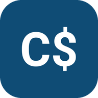
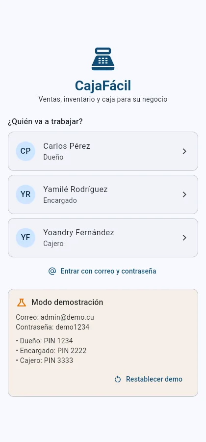
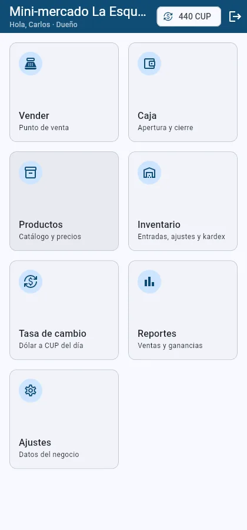
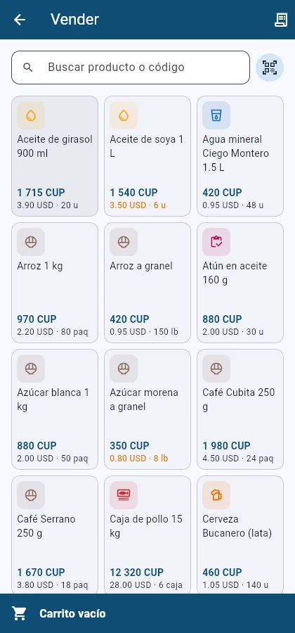
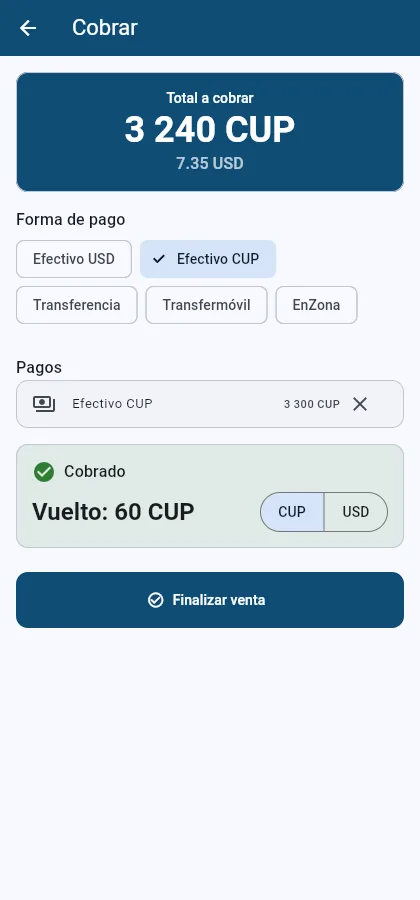
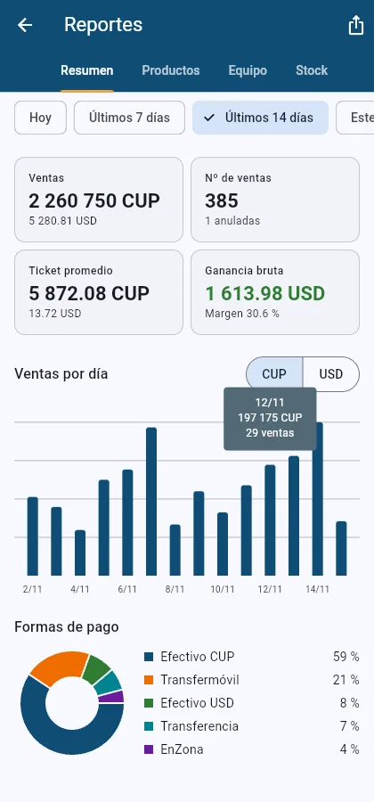
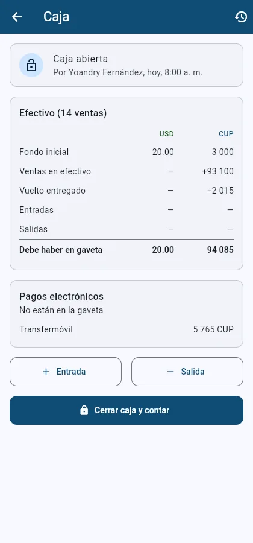
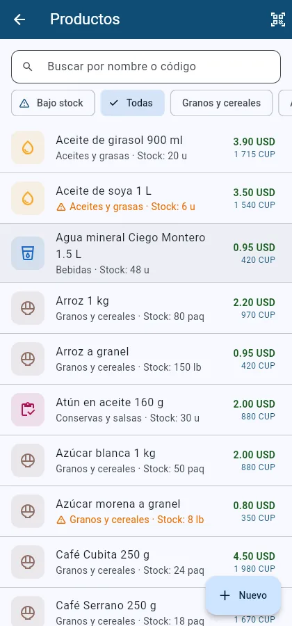
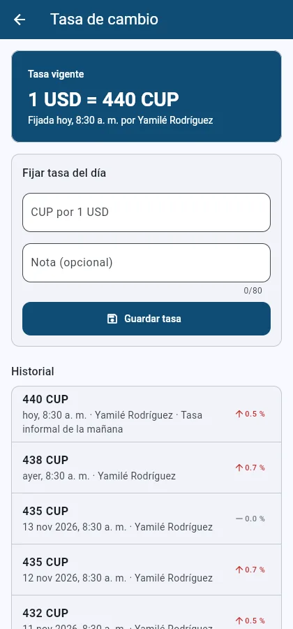
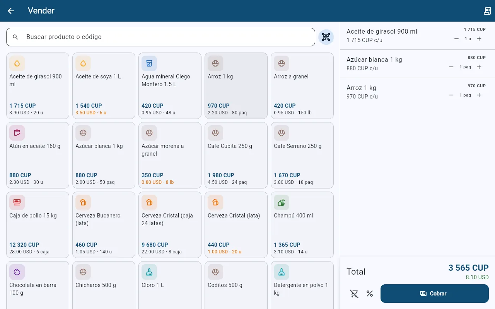

<div align="center">



# CajaFácil

**Punto de venta, inventario y caja para mipymes cubanas.**
Funciona sin internet, vende en **USD y CUP** y cuadra la caja por moneda.

[](https://github.com/Tiza-Coderz/cajafacil/actions/workflows/ci.yml)
[](https://github.com/Tiza-Coderz/cajafacil/releases)


**[▶ Probar la demo web](https://tiza-coderz.github.io/cajafacil/)** ·
**[⬇ Descargar APK](https://github.com/Tiza-Coderz/cajafacil/releases/latest)**

</div>

---

## El problema

Una bodega o mini-mercado en Cuba vende en **dos monedas a la vez**, con una
**tasa que cambia casi a diario**, cobra en efectivo, **Transfermóvil**,
**EnZona** o transferencia, y muchas veces **sin conexión** (apagones, datos
caros). Lo habitual es una libreta y una calculadora:

- Los precios en CUP se recalculan a mano cada vez que sube la tasa.
- El vuelto en pagos mixtos (dólares + pesos) se calcula de cabeza y se pierde dinero.
- Al cierre nadie sabe cuánto debía haber en la gaveta de cada moneda.
- No se sabe qué productos dejan ganancia ni cuándo reponer.

**CajaFácil** resuelve eso en el teléfono o la computadora que el negocio ya
tiene, sin depender de internet.

## Funcionalidades

| Módulo | Qué hace |
|---|---|
| **Acceso por PIN** | Cada empleado entra con su PIN. Roles **Dueño, Encargado y Cajero** con permisos distintos. Bloqueo temporal tras 5 intentos. |
| **Tasa de cambio** | Tasa USD→CUP del día con historial, autor y aviso ante cambios bruscos. Todos los precios en CUP se actualizan solos. |
| **Productos** | Precio base en USD; precio en CUP **calculado con la tasa o fijo**. Código de barras (cámara o lector USB), foto, unidad (u, lb, kg…), stock mínimo y margen en vivo. |
| **Punto de venta** | Búsqueda y escaneo, ventas a granel (2.5 lb), descuentos por línea o al total, **pago mixto** (Efectivo USD/CUP, Transferencia, Transfermóvil, EnZona), **vuelto en la moneda que pida el cliente**, ticket en pantalla, **PDF 80 mm** y **WhatsApp**. |
| **Caja** | Apertura con fondo, entradas/salidas de efectivo, resumen en vivo y **cierre con conteo por billetes** (incluye el de 3 CUP) y diferencia por moneda. Historial de cierres. |
| **Inventario** | Entradas de mercancía con proveedor y **costo promedio ponderado**, ajustes por merma, rotura, consumo, robo o conteo, y **kardex** por producto. |
| **Reportes** | Ventas por rango, por día (gráfico), por producto (top 10), por cajero y por forma de pago; **ganancia bruta y margen** (solo el dueño); bajo stock con cantidad sugerida. Exporta **PDF** y **CSV listo para Excel**. |
| **Ajustes** | Datos del negocio (logo, NIT, dirección), moneda principal, redondeo de CUP (1/5/10 pesos), usuarios y soporte por WhatsApp. |
| **Sincronización (opcional)** | Varias cajas o el dueño desde casa con **Supabase**: cola de cambios, "último cambio gana" y **ninguna venta se pierde** aunque dos cajas vendan sin conexión. |

## Capturas

| Acceso | Inicio | Punto de venta | Cobro mixto |
|:-:|:-:|:-:|:-:|
|  |  |  |  |
| **Reportes** | **Caja** | **Productos** | **Tasa del día** |
|  |  |  |  |

<p align="center"></p>

## Demo

- **Web:** <https://tiza-coderz.github.io/cajafacil/> (no necesita servidor: los datos viven en su navegador).
- **Android:** APK en [Releases](https://github.com/Tiza-Coderz/cajafacil/releases/latest) (`arm64` para teléfonos actuales, `universal` si tiene dudas).

Negocio de ejemplo: **Mini-mercado La Esquina, Playa** con 60 productos
cubanos y **2 semanas de ventas** ya registradas.

| Usuario | Acceso |
|---|---|
| Carlos Pérez (Dueño) | PIN **1234** · o correo `admin@demo.cu` / contraseña `demo1234` |
| Yamilé Rodríguez (Encargada) | PIN **2222** |
| Yoandry Fernández (Cajero) | PIN **3333** |

El botón **Restablecer demo** (en el acceso y en Ajustes) vuelve a cargar los datos de ejemplo.

## Stack

- **Flutter 3.32 / Dart 3.8** (Android + Web, una sola base de código)
- **Riverpod 3** con generador de código · **go_router** · **Freezed**
- **Drift** (SQLite nativo en Android; **SQLite WASM** en Web, persistido en IndexedDB/OPFS)
- **fl_chart** (gráficos) · **pdf/printing** (tickets e informes) · **mobile_scanner** (códigos de barras)
- **Supabase** (opcional) vía REST, sin SDK
- **GitHub Actions**: lint, tests, APK y despliegue web

## Arquitectura

Clean Architecture **por feature** (`data` / `domain` / `presentation`) sobre
un núcleo compartido. Detalle en [`docs/architecture.md`](docs/architecture.md)
y decisiones en [`docs/adr/`](docs/adr).

```
lib/
├─ app/            router (guardas por permiso), tema #0f4c75
├─ core/           dinero, BD (Drift), auth, sync, widgets comunes
└─ features/
   ├─ auth/  products/  exchange_rate/  pos/  cash_register/
   ├─ inventory/  reports/  settings/  demo/  home/
   └─ <feature>/{data, domain, presentation}
```

Decisiones clave:

- **Offline-first**: la base de datos local es la fuente de verdad; internet es opcional.
- **Dinero en centavos enteros** (`Money`) y cantidades en milésimas: nunca `double` con dinero.
- **Lógica crítica en Dart puro** y testeada: totales y descuentos, **vuelto multi-moneda**, **cuadre de caja**, costo promedio, sincronización.
- **Kardex de solo inserción**: el stock es una proyección de los movimientos, así sincronizar varias cajas no pierde ventas.
- **Patrón outbox** + "último cambio gana" con cursor del servidor ([ADR 0002](docs/adr/0002-sincronizacion-ultimo-cambio-gana.md)).
- **Pensado para conexiones lentas**: la web no descarga nada de Google (CanvasKit y fuentes van incluidos), pantalla de carga instantánea, imágenes WebP y miniaturas de pocos KB.

## Calidad

- `very_good_analysis` + `strict-casts/inference/raw-types`, cero avisos.
- **170+ tests** unitarios, de repositorio (SQLite en memoria) y de widgets, incluida la simulación de **dos cajas sincronizando**.
- CI en cada PR: formato, análisis, tests con cobertura, build web y APK.
- Git Flow con PRs, Conventional Commits, releases etiquetadas y [CHANGELOG](CHANGELOG.md).

## Correr en local

Requisitos: Flutter **3.32.x**, y JDK 17 para compilar Android.

```bash
git clone https://github.com/Tiza-Coderz/cajafacil.git
cd cajafacil
cp .env.example .env            # opcional: ajuste DEMO_MODE / SYNC_ENABLED
flutter pub get
dart run build_runner build --delete-conflicting-outputs

flutter run -d chrome --dart-define-from-file=.env     # Web
flutter run -d <android> --dart-define-from-file=.env  # Android
flutter test                                           # tests
```

> El código generado (`*.g.dart`, `*.freezed.dart`) no se versiona: ejecute
> `build_runner` tras cada `pub get`.

## Desplegar gratis

| Qué | Dónde | Cómo |
|---|---|---|
| Demo web | **GitHub Pages** | Automático al integrar en `main` (`.github/workflows/deploy-web.yml`). Alternativas: Cloudflare Pages o Netlify con `flutter build web --release --no-web-resources-cdn`. |
| App Android | **GitHub Releases** | Automático al crear un tag `vX.Y.Z` (`release-android.yml`). Se publican APK por arquitectura (~3× más livianos). |
| Sincronización | **Supabase** (plan gratuito) | 1) Crear proyecto. 2) Ejecutar `supabase/migrations/0001_sync_records.sql`. 3) Crear el usuario del dueño en *Authentication*. 4) Compilar con `SYNC_ENABLED=true`, `SUPABASE_URL` y `SUPABASE_ANON_KEY`. |

Firma de Android para producción: cree un keystore y configure los secrets
`ANDROID_KEYSTORE_BASE64`, `ANDROID_KEYSTORE_PASSWORD`, `ANDROID_KEY_ALIAS`
y `ANDROID_KEY_PASSWORD` (sin ellos se firma con la clave de depuración,
válido para la demo).

## Contacto

¿Quiere CajaFácil adaptado a su negocio (cafetería, ferretería, farmacia,
dulcería…)? Escríbame por WhatsApp o abra un *issue*.

---

## English summary

**CajaFácil** is an offline-first **point of sale, inventory and cash
register app for Cuban small businesses**, built with Flutter for Android and
Web. It handles the real constraints of the Cuban market: **dual currency
(USD/CUP) with a daily exchange rate**, mixed payments (cash, Transfermóvil,
EnZona, bank transfer) with **change in the customer's chosen currency**,
per-currency cash reconciliation with bill counting, and unreliable
connectivity.

Highlights: Clean Architecture per feature, Riverpod 3, go_router, Freezed,
**Drift (SQLite on Android and SQLite-WASM on the web, no backend needed)**,
integer-cents money, an insert-only stock ledger, a transactional outbox with
**last-write-wins sync to Supabase** (server-side trigger + server sequence
cursor), PDF receipts/reports, Excel-friendly CSV exports, 170+ tests
(including a two-register sync simulation) and CI/CD that ships split APKs
and deploys the web demo to GitHub Pages. The web build avoids Google CDNs
entirely (often slow or blocked from Cuba) and shows an instant splash.

Live demo: <https://tiza-coderz.github.io/cajafacil/> — owner PIN `1234`
(or `admin@demo.cu` / `demo1234`), manager `2222`, cashier `3333`.
